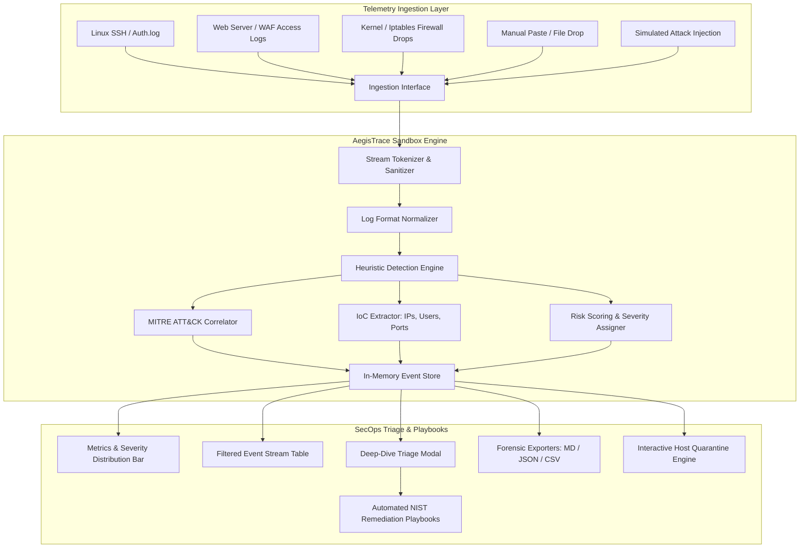
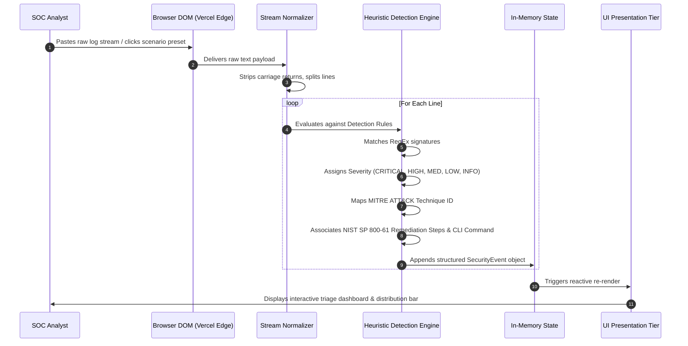

# AegisTrace v3.0 — Security Architecture Specification
### Module 06 Capstone Project &bull; Cybersecurity & Ethical Hacking Virtual Internship
**Codomax Digital Solutions**

---

## 1. System Overview & Core Philosophy

**AegisTrace** is engineered as a secure, decentralized, zero-backend **Security Operations Center (SOC) Log Analyzer and Alert Triage Workbench**, deployed natively on **Vercel Production Edge**. Traditional log aggregation solutions (e.g., SIEM appliances, centralized cloud log collectors) introduce several critical operational challenges:
- High operational overhead, compute sizing, and infrastructure management costs.
- Significant compliance risks (GDPR, HIPAA, PCI-DSS) when raw logs containing Personally Identifiable Information (PII) or credentials are submitted over the network to external SaaS backends.
- Slow incident turnaround when an analyst needs immediate, lightweight parsing of an isolated host's auth or web log.

To solve these challenges, AegisTrace adopts an **"Air-Gapped Client-Sandbox Model"**: all ingestion, normalization, heuristic detection, IoC extraction, and report compilation occur exclusively in-memory within the local browser sandbox, served via hardened edge routing on Vercel.



---

## 2. Component Architecture

The AegisTrace workbench is structured into modular layers designed for high throughput, predictable memory consumption, and zero external network leakage:

### 2.1 Ingestion & Normalization Layer
The ingestion interface accepts multiline plain-text streams via direct DOM text input or HTML5 File API streams. Upon ingestion, the **Log Format Normalizer** parses heterogeneous formats into an internal standardized schema:

| Target Field | Syslog / Auth Format | Apache / Nginx Combined | Iptables / Kernel Netfilter |
| :--- | :--- | :--- | :--- |
| `timestamp` | `Mmm DD HH:MM:SS` | `[DD/Mmm/YYYY:HH:MM:SS Z]` | Host Syslog Header or Extracted |
| `srcIP` | Extracted via IPv4 regex | Extracted from client token | Extracted from `SRC=` token |
| `user` | Extracted from `user <name>` | Extracted from auth identity token | Kernel process / N/A |
| `raw` | Full un-truncated line | Full un-truncated line | Full un-truncated line |
| `category` | Credential Access / SSH | Web Application / HTTP | Network Perimeter Recon |

### 2.2 Heuristic Detection & Correlation Engine
The core rules engine evaluates each normalized event sequentially against a priority-ordered catalog of regular expressions and signature heuristics:



---

## 3. Threat Detection Rules & MITRE ATT&CK Mapping

AegisTrace features an extensible rule catalog targeting high-impact adversary techniques:

| Rule ID | Detection Signature Focus | Severity | MITRE ATT&CK ID | MITRE Technique Name | Containment CLI Generated |
| :--- | :--- | :---: | :---: | :--- | :--- |
| `RULE_CMD_INJECT_C2` | `curl/wget` piped into shell (`\| bash`, `; sh`) | **CRITICAL** | `T1059.004` / `T1105` | Unix Shell Execution / Ingress Tool Transfer | `iptables -A OUTPUT -d <IP> -j DROP` |
| `RULE_SHELLSHOCK` | Bash environment function exploit `() { :; };` | **CRITICAL** | `T1190` | Exploit Public-Facing Application | `iptables -I INPUT 1 -s <IP> -j DROP` |
| `RULE_PATH_TRAVERSAL` | Directory traversal (`../../etc/passwd`) | **CRITICAL** | `T1083` / `T1005` | File and Directory Discovery / Data from Local System | `iptables -I INPUT 1 -s <IP> -j DROP` |
| `RULE_SQLI_BASIC` | SQL syntax injection (`UNION SELECT`, `' OR '1'='1`) | **HIGH** | `T1190` | Exploit Public-Facing Application | `fail2ban-client set nginx banip <IP>` |
| `RULE_ENV_LEAK` | Probing hidden files (`.env`, `wp-config.php`, `.git`) | **HIGH** | `T1552.001` | Credentials in Files | `nginx -s reload # (Check deny rules)` |
| `RULE_SUSPICIOUS_OUTBOUND` | Egress connections to ports `4444`, `1337`, `8888` | **HIGH** | `T1071.001` / `T1571` | Web Protocols / Non-Standard Port C2 | `iptables -A OUTPUT -p tcp -m multiport --dports 4444,1337,8888 -j REJECT` |
| `RULE_ROOT_LOGIN` | Direct accepted root password authentication | **HIGH** | `T1078.003` | Valid Accounts: Default Accounts | `sed -i 's/^PermitRootLogin.*/PermitRootLogin no/' /etc/ssh/sshd_config` |
| `RULE_SSH_AUTH_FAIL` | Repeated invalid SSH password attempts | **MEDIUM** | `T1110.001` | Brute Force: Password Guessing | `fail2ban-client set sshd banip <IP>` |
| `RULE_SCANNER_UA` | Automated scanner signatures (`Nikto`, `sqlmap`) | **MEDIUM** | `T1595.002` | Active Scanning: Vulnerability Scanning | `iptables -A INPUT -m string --string "Nikto" -j DROP` |
| `RULE_PORT_SCAN_DROPS` | Consecutive firewall SYN drops across ports | **LOW** | `T1046` | Network Service Discovery | `ipset add blacklist <IP>` |

---

## 4. Access Control, Privacy & Data Protection

### 4.1 Zero-Telemetry Data Privacy Guarantee
Traditional web apps inadvertently leak sensitive data through analytics, logging SDKs, or error monitoring agents. AegisTrace enforces:
- **No Third-Party Trackers:** Zero external analytics, tracking pixels, or remote telemetry SDKs.
- **Ephemerality by Design:** Log records are stored only in volatile JavaScript heap memory (`state.parsedEvents`). Closing or refreshing the tab permanently purges all processed log lines.
- **Air-Gap Capability:** Once loaded, AegisTrace requires zero network connectivity. Analysts can disconnect network adapters or run the dashboard in an offline security clean room.

### 4.2 Cross-Site Scripting (XSS) Mitigation Architecture
Attackers routinely craft User-Agent strings, URI paths, and usernames that embed malicious HTML/JavaScript payloads (e.g., `<script>alert(1)</script>`, `">`).

AegisTrace addresses this threat through a strict output sanitization gateway:
```javascript
function escapeHTML(str) {
  if (!str) return '';
  return String(str)
    .replace(/&/g, '&amp;')
    .replace(/</g, '&lt;')
    .replace(/>/g, '&gt;')
    .replace(/"/g, '&quot;')
    .replace(/'/g, '&#39;');
}
```
All dynamic table cells, modal values, and raw log text blocks are rigorously sanitized prior to DOM insertion, preventing DOM-based or Stored XSS attacks even when adversarial logs are ingested.

---

## 5. Vercel Production Security Posture (`vercel.json`)

When deployed to Vercel, AegisTrace enforces enterprise-grade security headers configured in `vercel.json`:

```json
{
  "version": 2,
  "cleanUrls": true,
  "headers": [
    {
      "source": "/(.*)",
      "headers": [
        { "key": "Content-Security-Policy", "value": "default-src 'self'; style-src 'self' https://fonts.googleapis.com 'unsafe-inline'; font-src 'self' https://fonts.gstatic.com data:; script-src 'self' 'unsafe-inline'; img-src 'self' data: https:; connect-src 'none'; frame-ancestors 'none';" },
        { "key": "X-Frame-Options", "value": "DENY" },
        { "key": "X-Content-Type-Options", "value": "nosniff" },
        { "key": "Referrer-Policy", "value": "strict-origin-when-cross-origin" },
        { "key": "Permissions-Policy", "value": "camera=(), microphone=(), geolocation=(), payment=()" },
        { "key": "Strict-Transport-Security", "value": "max-age=63072000; includeSubDomains; preload" }
      ]
    }
  ]
}
```

- `connect-src 'none'`: Enforces that no XMLHttpRequests, Fetch calls, or WebSockets can be opened by the page, architecturally preventing data exfiltration.
- `X-Frame-Options: DENY`: Prevents clickjacking attacks by forbidding iframe embedding on untrusted origins.
- `X-Content-Type-Options: nosniff`: Prevents MIME-type sniffing vulnerabilities.
- `Strict-Transport-Security`: Enforces TLS encryption for 2 years with preload.
